# The common process

Every role uses the same ten stages in the same order. What changes by level is the format and length of the technical stages, the evaluation method and who sits on the panel. See the [role tracks](../roles/index.md).

```mermaid
flowchart LR
  A[1 Role kickoff]:::new --> B[2 Panel and briefing]:::new --> C[3 CV screen] --> D[4 HR screen] --> E[5 Technical interview]
  E --> F[6 Evaluation exercise] --> G[7 Team interview]:::new --> H[8 HR culture interview]:::new --> I[9 Debrief and decision] --> J[10 Offer and 90 days]
  classDef new fill:#FDEBE5,stroke:#E85A36,color:#050F1C
```

Orange stages are new for most teams. Any stage can end in a decline.

| # | Stage | Owner | Output |
| --- | --- | --- | --- |
| 1 | Role kickoff | Project hiring lead, TA | Project Hiring Brief, role track and must-haves |
| 2 | Panel and briefing | Hiring lead | Named panel; 30-min context briefing held |
| 3 | CV screen | TA, hiring lead | Shortlist with needs-validation items |
| 4 | HR screen | TA / HR, 30 min | Logistics clear; process explained |
| 5 | Technical interview | Hiring lead, independent interviewer | Two independent feedback forms |
| 6 | Evaluation exercise | Project engineers | Role-specific evidence |
| 7 | Team interview | Project team | Team feedback on working together |
| 8 | HR culture interview | HR partner | Scored culture form |
| 9 | Debrief and decision | Hiring lead chairs | Signed decision note |
| 10 | Offer and 90 days | TA, hiring lead | Offer; 90-day review on the same scorecard |

## How each role uses the stages

| Stage | Intern | SE | SSE | Tech Lead | Architect |
| --- | --- | --- | --- | --- | --- |
| 5 · Technical interview | 45 min, fundamentals and project walk-through | 75 min standard | 75 min standard | 75 min standard | 60 min architecture portfolio presentation |
| 6 · Evaluation exercise | Online coding test, 60 min | Pair programming 60 min, or take-home of 4 h or less | System design 60 min; case study or POC only for a named doubt | System design and code review 75 min; leadership scenario 60 min | Architecture kata 90 min; optional POC or design review |
| 7 · Team interview | Team meet, 30 min | 45 min with project engineers | 60 min code review session | 60 min with future reports and delivery manager | 60 min with tech leads and delivery head |
| 8 · HR culture interview | 30 min | 45 min | 45 min | 45 min | 45 min |
| Senior conversation | – | – | – | Head of engineering, 30 min (optional) | CTO, 45 min |
| Candidate time, excluding take-homes | ≈ 3 h | ≈ 4 h | ≈ 5 h | ≈ 6 h | ≈ 6 h |
| Target days to decision | 14 | 21 | 21 (28 with case study) | 28 | 35 |
